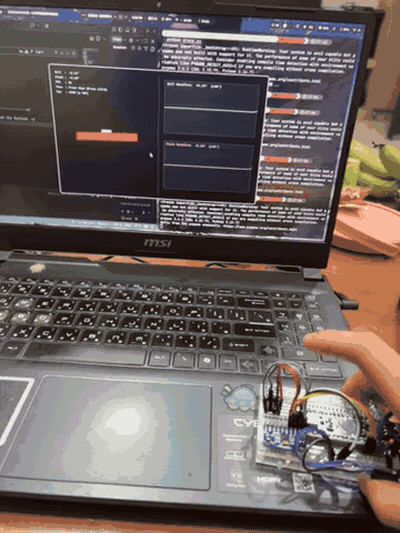
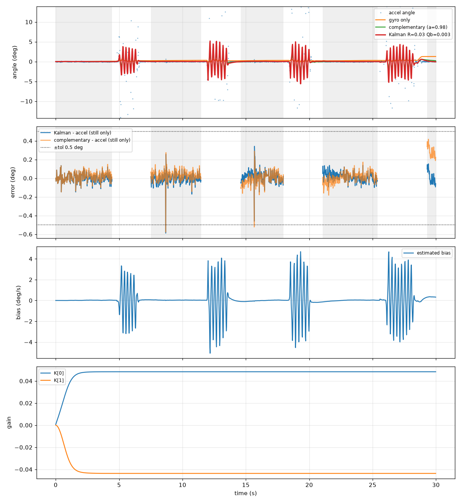
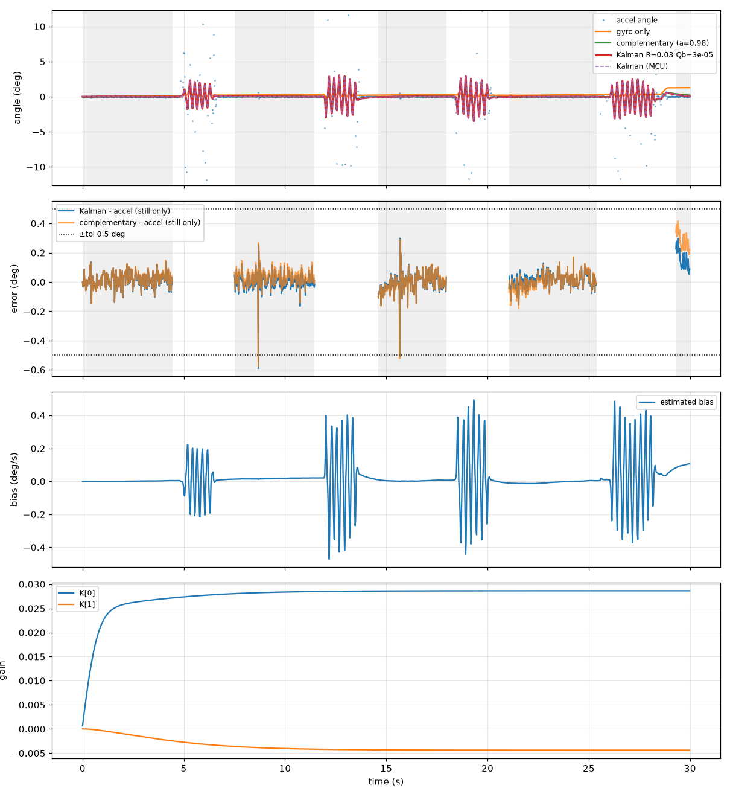
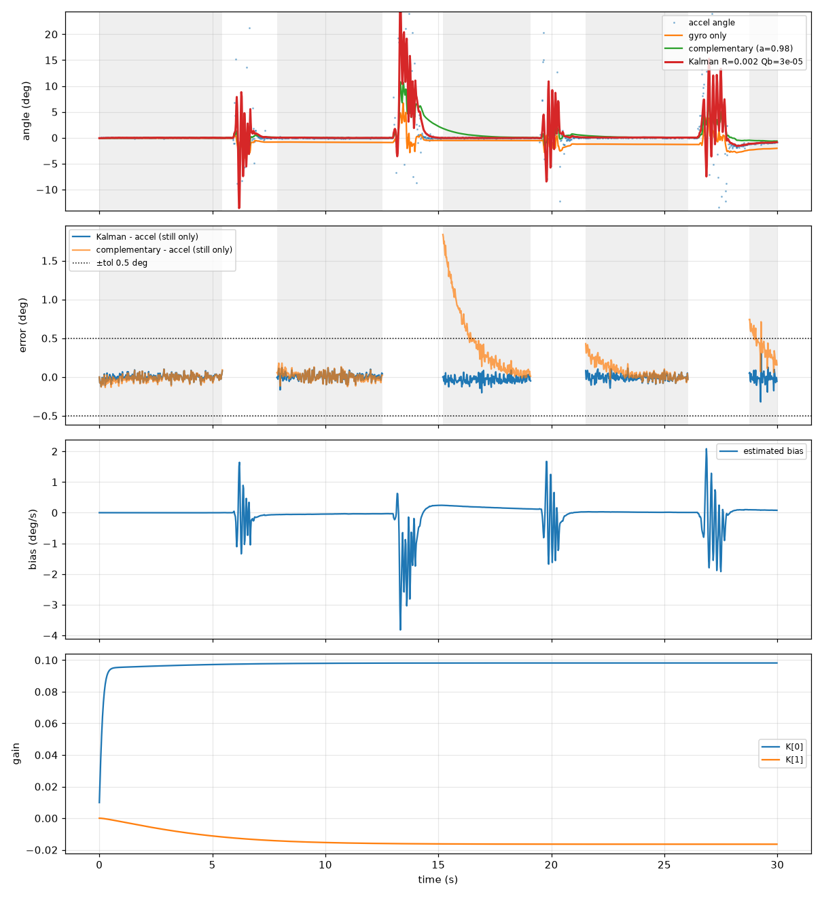

# STM32F411 IMU Attitude Estimation with a Kalman Filter

> **中文摘要**:在 STM32F411 上以 I2C 讀取 MPU6500,實作二狀態卡爾曼濾波(角度與陀螺儀零偏),50 Hz 即時輸出姿態。以 Python 參考實作逐點驗證 MCU 輸出(差異 < 0.005°),單次濾波約 3.8 µs。透過實測資料進行參數實驗,發現晃動時加速度計干擾會汙染零偏估計;將零偏過程雜訊 Qb 由 0.003 降至 3e-5 後,同一份資料的零偏偏移由 5.08°/s 降至 0.49°/s,並量化了抗干擾與恢復速度的取捨。



## Hardware

- STM32F411CEU6 "Black Pill", 25 MHz HSE → 100 MHz SYSCLK
- MPU6500 on I2C1 (PB6 SCL, PB7 SDA), address 0x68, ±250 dps / ±2 g, on-chip DLPF ≈ 20 Hz
- USB-UART adapter on USART1 (PA9 TX, PA10 RX), 115200 baud
- Built with STM32CubeMX (HAL) + CMake + VS Code on Arch Linux

## How it works

A 2-state Kalman filter per axis, state `x = [angle, gyro_bias]`:

1. **Predict** with the gyro: `angle += dt · (gyro − bias)`, bias assumed constant.
2. **Propagate covariance**: `P = F P Fᵀ + Q`, with `F = [[1, −dt], [0, 1]]`.
3. **Gain**: `K = P Hᵀ / (H P Hᵀ + R)`, `H = [1, 0]` (the accelerometer measures angle only).
4. **Update** with the accelerometer angle: `x += K · (acc_angle − angle)`.
5. **Update covariance**: `P = (I − K H) P`.

Because the gyro bias is a state, the filter removes slow gyro drift on its own, which a complementary filter cannot do.

Firmware details:

- Checks `WHO_AM_I` at boot; on failure the LED blinks fast and the reason is printed over UART.
- Calibration averages only successful I2C reads; failed reads carry their `dt` over to the next sample.
- `dt` comes from the DWT cycle counter (µs resolution); filter execution time is measured the same way.
- Innovation and angle are wrapped to ±180°.
- Output is CSV with integer milli-units, so no float `printf` is needed.

## Results

### 1. The MCU implementation matches a Python reference

The same logged sensor data is run through a line-by-line Python port of the filter and compared with the MCU output.

| Recording | Python vs MCU (RMS) |
|---|---|
| still | 0.0011° |
| tilt | 0.0048° |
| shake | 0.0026° |
| shake_v2 (after changing Qb) | 0.0022° |

The small differences come from how `dt` is computed on each side. The last row is a regression check after retuning.

### 2. Timing and sensor noise

| Metric | Value |
|---|---|
| Two filter updates (roll + pitch) | 7.51 µs at 100 MHz (≈3.8 µs each, <0.04% of the 20 ms period) |
| Accelerometer angle variance at rest | 0.0016–0.0024 deg² (std ≈ 0.05°) |
| I2C errors | 0 in 1500 samples |

### 3. How the filter was evaluated without ground truth

There is no reference angle during motion, so the filter is scored only when the board is **at rest**, where the accelerometer measures gravity alone and is a reliable reference.

- A sample counts as *moving* if |gyro| > 3°/s or the accelerometer angle's rolling std > 0.5°.
- A sample counts as *still* only if there is no movement within ±0.5 s. Looking at future samples is fine for offline analysis; a first version looked only backwards and misclassified the onset of motion as "still", which made every recovery time look like ~4.8 s regardless of parameters. A metric that does not change with the parameters was the clue that it was measuring the method, not the filter.
- **Recovery time**: from the end of motion until |estimate − accel| stays below 0.5°. The lower bound is 0.5 s because of the stillness window.
- **Still residual**: RMS of estimate − accel after recovery.

### 4. Parameter study

First shake recording, `Qa = 0.001`:

| R | Qb | Static noise (°) | Max bias excursion (°/s) | Recovery mean / max (s) | Still residual (°) |
|---|---|---|---|---|---|
| 0.002 | 0.003 | 0.019 | 37.08 | 0.50 / 0.50 | 0.092 |
| 0.002 | 3e-5 | 0.018 | 3.83 | 0.50 / 0.50 | 0.052 |
| 0.03 | 0.003 | 0.029 | 10.86 | 1.07 / 2.24 | 0.115 |
| 0.03 | 3e-5 | 0.025 | 1.35 | 0.83 / 1.26 | 0.119 |
| 0.3 | 0.003 | 0.036 | 4.34 | 1.66 / 4.04 | 0.159 |
| 0.3 | 3e-5 | 0.015 | 0.56 | 1.57 / 3.62 | 0.152 |

- **Lowering Qb is an almost free improvement**: at every R it cuts the bias excursion by roughly 3–10× with little cost in recovery or residual.
- **R is the real trade-off**: larger R resists accelerometer disturbances, smaller R recovers faster and sits closer to the accelerometer at rest. Small R also lets the estimate swing much more *during* shaking, which this table cannot measure.
- Only one 30 s recording with 4 shakes was used, so single rows are noisy; the trends are what matter.

**Chosen: R = 0.03, Qb = 3e-5** as a balance between disturbance rejection and recovery speed.

### 5. Same data, old vs new parameters

Second shake recording (`shake_v2`), R = 0.03, only Qb changed:

| | Qb = 0.003 (old) | Qb = 3e-5 (new) |
|---|---|---|
| Max bias excursion | 5.08°/s | **0.49°/s** |
| Angle swing during shaking | ≈ ±5° | **≈ ±3°** |
| Static noise | 0.011° | 0.007° |
| Recovery mean / max | 0.80 / 1.70 s | 1.07 / 1.70 s |
| Still residual | 0.060° | 0.070° |

Changing only Qb also changed the converged angle gain K[0] from 0.048 to 0.029: the parameters are coupled through the covariance P.

| Qb = 0.003 | Qb = 3e-5 |
|---|---|
|  |  |

### 6. Kalman vs complementary filter



After the shake at ~13 s, the complementary filter (α = 0.98) needs about 3 s to return to the correct angle, while the Kalman filter is back almost immediately. Grey regions are the detected still periods; the second panel shows estimate − accelerometer during those periods.

## Findings and limitations

- **Accelerometer disturbances leak into the bias estimate.** During shaking, linear acceleration violates the fixed-R noise assumption, and the filter "explains" the mismatch by moving the bias, which then corrupts the angle after the shake. Lowering Qb reduces this.
- **Pure gyro integration is not a valid reference during hand shaking.** Hand motion is not a pure roll, and integrating only `gx` ignores the coupling from the other axes; the board also reads only one of every four 200 Hz sensor samples. After several shakes the gyro-only angle ends up offset by 1–2° even though the board is back on the table. Peak rate was 184°/s, so the ±250 dps range was not saturated.
- **No dynamic ground truth.** All scoring is done at rest.

## Next steps

- Adaptive R / accelerometer gating: raise R or skip the update when |a| deviates from 1 g.
- Read every sample with a data-ready interrupt and I2C DMA at 200 Hz or more.
- Full 3-D attitude (quaternion, e.g. Mahony/Madgwick) instead of independent roll/pitch filters.
- Dynamic ground truth by mounting the IMU on a motor shaft with an encoder (e.g. an ODrive axis).

## Usage

```bash
# record 30 s from the board (press RESET, keep still during calibration)
python tools/f411_logger.py /dev/ttyUSB0 --seconds 30 --out shake.csv

# run the Python reference with the firmware parameters, compare with the MCU
python tools/kalman_sim.py shake_roll.csv

# try other parameters / sweep
python tools/kalman_sim.py shake_roll.csv --R 0.3 --Qb 3e-5
python tools/kalman_sim.py shake_roll.csv --sweep
```

## Credits

- The 2-state filter structure follows the widely used open-source Kalman filter by TKJ Electronics (Kristian Lauszus).
- The first firmware draft was written with AI assistance; I then reviewed it, fixed the issues listed above, built the Python reference and analysis tools, and validated everything on hardware.
